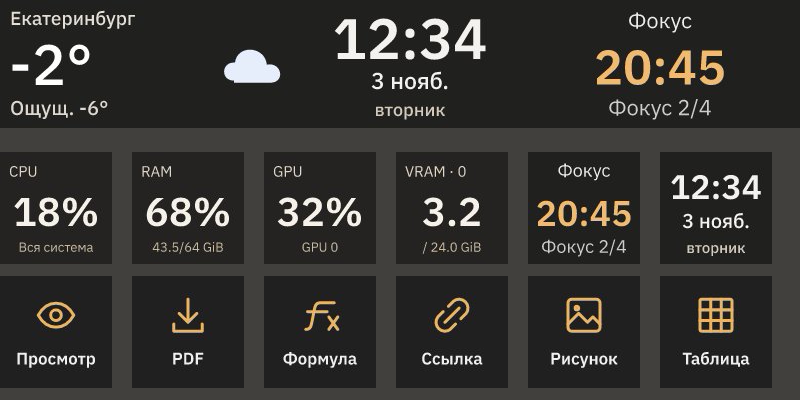

# Личное рабочее место

Mirabox использует новый основной профиль **«Рабочий стол»**. Tools, Default,
Acceptance, IO84, настройки и сочетания клавиш VS Code сохранены. Elgato Weather
выключен. На всех страницах полоса: Екатеринбург, дата/время, общий помодоро.

| Страница | Кнопки слева направо, сначала верхний ряд |
| --- | --- |
| Главная | VS Code, Codex, браузер, Telegram, Телемост; Zotero, Отчёты, Codex · команды, Браузер · команды, Нагрузка |
| Отчёты | Превью, PDF, структура, формула, ссылка; рисунок, таблица, жирный, курсив, Главная |
| Codex | Codex, команды, поиск, предыдущий чат, следующий чат; терминал, Codex в VS Code, новый чат в VS Code, добавить выделение, Главная |
| Браузер | Назад, вперёд, обновить, новая вкладка, предыдущая вкладка; следующая вкладка, адрес/поиск, поиск на странице, масштаб 100%, Главная |
| Нагрузка | CPU, RAM, GPU, VRAM, помодоро; пауза, сброс, следующий этап, время работы Windows, Главная |

| Крутилка | Действие |
| --- | --- |
| D1 | Громкость Windows; нажатие включает/выключает звук |
| D2 | Нажатие запускает/приостанавливает помодоро |
| D3 | На странице браузера: масштаб; нажатие возвращает 100%. На остальных свободна |
| D4 | Перелистывание страниц |

Касание помодоро тоже запускает/приостанавливает его. Цикл: 25 минут работы,
5 минут отдыха, 15 минут после четырёх рабочих этапов. Следующий этап вручную.
Сигнал `complete`, громкость 35%. Настройки общие для цикла `personal`.
Смена профиля/страницы не останавливает его; перезапуск не повторяет пропущенный
сигнал. «Сброс» возвращает первый рабочий этап.

Для отчётов откройте нужный Typst-файл в VS Code. Команды используют активный
документ/выделение и обычные настройки Typewriter 0.3.10/Tinymist. PDF сохраняется
в настроенное расширением место. Рисунок/таблица открывают обычные диалоги.
Отмена VS Code работает; формула/ссылка могут требовать две отмены из-за импорта.
Локальное расширение `deckweave.workspace-0.1.0` установлено. Если старое окно
не подхватило его, выполните Developer: Reload Window один раз.
«Добавить выделение» помещает текст в редактор сообщения Codex; отправка вручную.

Браузер по умолчанию — Zen. Адрес/поиск только выделяет адресную строку; Найти
открывает поиск на странице. Ввод и Enter вручную. Команды проверяют целевое окно.
GPU по умолчанию — RTX 3090 Ti; можно выбрать Intel UHD 770 в настройках действия.
GPU — наиболее загруженный физический движок, VRAM — выделенная память в GiB.
Обновление раз в две секунды. Нет данных, первичный замер и устаревшее значение
отличаются от настоящего нуля.

## Проверки

Полная `npm run check`, SDK и реестр проходят проверки. Настройка проверена на
копии базы, применена одной транзакцией; повторный запуск не создаёт дубликат.
[Настоящий VS Code, нативная активация, канал, Typewriter и undo](../integrations/vscode/evidence/2026-11-03-fixture.json).
[SDK → скрытый помодоро → один сигнал Windows → тот же цикл без новых окон](evidence/2026-11-03/personal-workspace-native-smoke.json).
[GPU на этом ПК](evidence/2026-11-03/personal-workspace-gpu.json).
[Исправление исчезающих кнопок и проверка запуска приложений](BUTTON-FEEDBACK-RESULT.md).

Иллюстративные состояния после настоящего JPEG-рендерера Mirabox, в нативном
размере. Это проверка отрисовки, не фотография физических экранов.

## Что проверить владельцу

1. Читаемость погоды, даты и таймера на физической полосе с рабочего расстояния.
2. Комфортность сигнала: временно задайте рабочий этап в одну минуту, запустите,
   уйдите на другую страницу, дождитесь одного сигнала и верните 25 минут.
   Скрытое завершение и переходы уже проверены; тестовый звук был нулевой громкости.
3. Превью и PDF в своём Typst-проекте: регистрации проверены, личные выходные
   файлы и проектные настройки не менялись.

Модельные проверки повторять не нужно. Заметки на кнопках, Telegram и почта —
следующий этап; источники сообщений не подключались.

## Повторение и восстановление

В корне: `npm run prepare:workspace`, затем `node scripts/personal-workspace.mjs`.
Последняя команда готовит проверочную копию. Для применения при закрытом DeckWeave:
`node scripts/personal-workspace.mjs --apply`. Пользовательские изменения своего
ранее установленного профиля она не заменяет автоматически.

Журнал с путями копий: `.local/personal-workspace/installed.json`. Сохранены обе
SQLite-базы и `.local/personal-workspace/previous-executable.exe`. Для старой
раскладки достаточно выбрать прежний профиль. Полный откат базы делать при
закрытом приложении, сохранив актуальную базу: он отменяет все последующие
изменения профилей. Старый executable не обслуживает новые задания помодоро.
Старые таймеры не конвертировались.

Clock, Focus, Workspace находятся в `plugins`, метаданные в соседнем
`plugin-registry`. Каждый пакет поддерживает `npm run validate`/`npm run pack`.
Helpers собирает `prepare:workspace`; они исключены из Git, обязательны в архиве.
