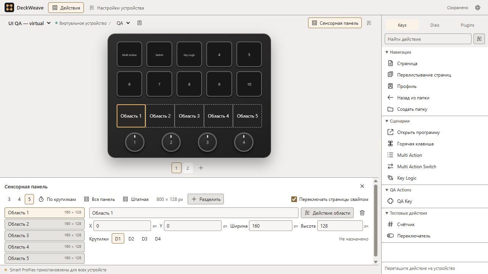

# Компактный интерфейс и явные назначения

Дата: 2026-11-02. Используется исходная иконка из прежнего DeckWeave. Единственный вид интерфейса — компактный; прежний переключатель плотности убран. Сохранённое поле предпочтений читается для совместимости базы, но не включает просторный вариант.

Библиотека теперь выбирает действие по клику. Она не меняет выбранную кнопку и не запускает действие. Для назначения нужно перетащить действие на нужный элемент или нажать явную команду «Назначить / Заменить · имя элемента» в нижней части библиотеки. Выбор действия с клавиатуры работает так же. Delete относится к элементу устройства или инспектору; фокус в библиотеке не удаляет прежнее назначение.

«Настроить список действий» показывает компактные строки групп с маркерами переноса и переключателями видимости. За маркер можно переместить группу; раскрытие группы даёт те же операции над её действиями. Скрытие группы сохраняет назначения и не отключает исполнение плагина. Включение исполнения, отключение и удаление пакета находятся в общих настройках. Для клавиатуры доступно Alt+↑/↓ на маркере переноса.

Панель инспектора занимает высоту содержимого до выбранного пользователем предела. Разделителем можно увеличить предел для сложных сценариев или уменьшить его с прокруткой. Пустой инспектор не резервирует большую область. Название, закрепление, параметры запуска и доступные команды объединены в строки/сетки; настройки плагина и удаление вынесены в шапку инспектора. Пустой результат для bitmap-плагина не показывается.

У действий разные SVG-иконки: навигация, запуск, сочетания клавиш, последовательности, Switch/Key Logic, крутилки, свет, погода, звук, таймеры, мониторинг и OBS. Неизвестный сторонний action использует общую иконку расширения. Названия действий остаются видимыми.

Общие настройки, реестр, параметры Mirabox, управление расширениями, окна установки/удаления и аппаратные настройки используют общую плотность. Для небольшого набора вариантов доступны отдельные кнопки: язык/масштаб, тип расширения, boolean/короткие enum настроек, слой клавиатуры и направление перелистывания. Неизвестные значения устройства остаются неизвестными, а не получают вымышленный процент.

Multi Action принимает действия из библиотеки в свой список, шаги переставляются за ручку (также Alt+↑/↓); справа — параметры выбранного шага. Switch показывает отдельные списки по вкладкам состояний. Key Logic и действия крутилки имеют вкладки событий с отдельными назначениями. Клик по библиотеке не заменяет вложенное действие: требуется перенос на его строку либо явная команда выбранного действия. Новые последовательности пустые; пустое состояние ничего не запускает. Несовместимые Controllers и вложенные Multi Action отклоняются до изменения конфигурации. Замена раскладки сенсорной панели требует подтверждения; отмена и устаревшее предложение сохраняют настройки. Выбор другого плагина в библиотеке после отключения пакета не оставляет доступную команду назначения устаревшего элемента.

Собственные PI Audio, Monitor, Timers, Weather, OBS и Diagnostics получили общий компактный stylesheet. Справка сворачивается, поля стоят в строках, начальный размер окна PI уменьшен до 600×480 и допускает изменение размера. Исходник стиля — `assets/branding/inspector.css`; `node scripts/sync-plugin-ui.mjs` переносит его в самостоятельные пакеты. Оригинальные PI сторонних Elgato-плагинов сохраняют оформление автора.

В предыдущем срезе плотности в Windows UI проверены редакторы IO84/Mirabox, общие настройки, реестр и параметры Mirabox, библиотека и её drag/switch, каталог OpenDeck, выбор релиза, предварительное удаление плагина с зависимостями и отменой, окно собственного PI, составной Switch и отмена замены его шага, предложение замены сенсорной раскладки. Контрольный отпечаток всех сохранённых действий и их настроек до/после совпал. Проверки не удаляли пакеты и не подтверждали замену аппаратных назначений.

Svelte, format, web build, Rust fmt/clippy/workspace tests, Weather и 41 plugin/UI tests прошли. В том числе добавлены проверки переноса с сохранением скрытых соседей, переноса в обе стороны и отказа переместить действие в чужую группу. Проверка исходников impeccable не выдала находок; она не является измерением контраста каждого стороннего PI.

[Правила оформления](../DESIGN.md), [результаты](evidence/2026-11-02/ui-density.json).

## Темы и сенсорная полоса

В Настройки → Общие доступны светлая/тёмная тема, пять готовых акцентов и произвольный цвет. Они сохраняются и применяются в окнах приложения; исходный тёмный вариант нейтральный, с янтарным акцентом. Текст выделения и цвет фокуса подбираются с учётом контраста. Системные списки имеют явные цвета options. Собственные PI следуют оформлению через необязательное расширение протокола; сторонние HTML-инспекторы сохраняют дизайн автора.

Кнопка «Сенсорная панель» находится в строке устройства. Её настройки используют нижний изменяемый инспектор и не выталкивают превью отдельным длинным блоком. Выберите область в списке либо прямо на полосе: подсветка соответствует её размерам. Справа находятся имя, X/Y/ширина/высота в пикселях, связи с крутилками и «Действие области». Перенос действия на полосу сразу открывает параметры назначения. Режимы плагина показываются кнопками с понятными названиями; единственный режим не занимает отдельное поле.

Пресеты 3/4/5 равных областей, «По крутилкам», «Вся панель» и «Штатная» меняют раскладку только после подтверждения. Числовые пресеты независимы от крутилок; связи настраиваются отдельно для каждой области. Повторный выбор текущего варианта не пересоздаёт области. Свободное место принимает новую область; если его нет, «Разделить» делит выбранную область по ширине, сохраняя прежний id, действие и связи в левой половине. Удаление области требует отдельного подтверждения. Размеры за пределами панели, слишком малые или пересекающиеся отклоняются с локальным объяснением; исходное значение остаётся видимым. Для вертикального деления сохранено предупреждение о необходимости аппаратной координаты Y.

В установленном Stream Deck повторно открыты Multi Action Switch, оба состояния и настройка шага: отдельный список и выбранный шаг приняты как ориентир. На изолированном стенде проверены добавление и перестановка шагов, отдельное состояние Switch, двойное нажатие, настройка четырёх областей и прямое назначение в область. Это проверка интерфейса, а runtime отдельно покрыт Rust-тестами. Приёмка новых аппаратных записей клавиатуры в эту работу не входит.

Иконка exe проверяется после release-сборки командой `node scripts/check-app-icon.mjs`: сравниваются все шесть кадров ICO с настоящими PE-ресурсами.

Итог этого продолжения: [проверки темы, составных действий и панели](evidence/2026-11-02/ui-appearance-composition-panel.json). На снимке ниже — отдельный виртуальный стенд, пять областей и независимая связь D1.

