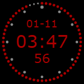

# Проверки совместимости плагинов

Дата: 2026-11-01. Новый DeckWeave ещё не содержит plugin host. Все исполняемые пробы ниже относятся к существующему диагностическому host из `G:\APPS\DeckWeave`.

Уточнение владельца: от обратной совместимости старых конфигураций отказываемся — импорт профилей Elgato/StreamDock и миграция данных старого DeckWeave не нужны. **Совместимость Elgato-плагинов сохраняется.** Отсутствие импорта не исключает их manifest, backend, Property Inspector, настройки action instances и feedback. Собственная сенсорная панель должна допускать размещение совместимых действий в областях; нельзя переносить ограничение Encoder canvas на возможности всего собственного panel API. [Требования панели](ADVANCED-INTERACTIONS.md).

## Проверенный набор

| Пакет | Версия | Результат | Что не проверено |
|---|---|---|---|
| On Air Clock, установленный | 1.3.0 | Регистрация; 12 setImage за 3 с, в пятисекундных прогонах 21; извлечён и просмотрен PNG 144×144 | PI в нашем host, сохранение настроек, encoder layout, физический N4, долгий прогон |
| Visual Studio Code, установленный | 5.1.3 | Нативный backend зарегистрирован; setSettings с пустыми arguments/command | PI, расширение VS Code, выполнение команд и фактический результат в редакторе |
| Tutorial, установленный | 1.0.4.3 | Старый scanner отвергает пакет: `EmptyField("Name")` | Runtime не запускался; нужно решить, показывать ли этот служебный пакет в новом каталоге |
| Stream Deck Icon Library, установленный | 2.2.0.175 | В metadata не обнаружен исполняемый CodePath | Это ресурсный пакет; отсутствие backend не следует считать падением action-плагина |
| Codex, установленный | Версия из защищённого manifest не извлекалась | `manifest.json` начинается с бинарного заголовка ELGATO | Исполнение в стороннем host и возможность получить совместимую открытую сборку |
| Weather, установленный | Версия из защищённого manifest не извлекалась | Такой же ELGATO-container | Исполнение; незашифрованная версия этого exact package не найдена/не испытывалась |
| OBS Studio, локальный архив | 2.2.4 | Регистрация HTML-backend; setSettings и setState=1 при willAppear; inputs=0 | Связь с OBS, PI, сцены/запись/звук, текущая Marketplace-версия |
| Elgato Hello World, локальный sample | 0.1.0.0 | Два виртуальных нажатия меняют settings/title: Click Me → Select property → Off | UI и persistence нового приложения; Node 20 из manifest отдельно не проверялся |

Установленные пакеты прочитаны из стандартного каталога Elgato. Пробы выполнялись на временных копиях. Пользовательские глобальные настройки/профили не переносились. Хеши manifest — [installed-packages.json](evidence/installed-packages.json).

## Что доказывает виртуальная проба

Hello World получает `willAppear`, затем `keyDown`, `keyUp`, `keyDown`, `keyUp` через WebSocket. Возвращаются настоящие сообщения backend. Это подтверждает исполняемый путь для sample; он не требует физической кнопки и пригоден как будущий сквозной тест. Этот путь пока не подключён к новому пользовательскому интерфейсу. Файл — [hello-world-input-probe.json](evidence/hello-world-input-probe.json).

Использован Node v26.12.1, тогда как manifest sample указывает 20. Успех этой пробы не разрешает игнорировать Nodejs.Version других плагинов. Новому launcher потребуется понятный выбор/поставка поддерживаемых runtimes.

## Изображение от действующего HTML-backend

Это PNG, полученный от плагина, не макет. Размер 144×144, 8852 bytes; [хеш и metadata](evidence/onairclock-frame.json). В отдельном трёхсекундном прогоне средняя длина data URI была около 11657 символов. Исходный `setImage` нужно декодировать/масштабировать/композировать для N4: получение PNG не доказывает вывод на оборудование.

On Air Clock использует canvas и worker-based timers. В изученном `app.js` есть очистка таймера при `willDisappear`. Следовательно, корректная lifecycle-доставка важна и для расхода ресурсов, и для исчезновения старых изображений после перехода на другую страницу.

## Нужные части совместимого host

По [протоколу Elgato](https://docs.elgato.com/streamdeck/sdk/references/websocket/plugin/) и изученному OpenDeck требуется больше, чем `keyDown → setImage`: manifest и platform CodePath, native/Node/HTML launcher, регистрация, contexts, willAppear/willDisappear, настройки/global settings, PI bridge, setTitle/setState, alerts, encoder feedback/layouts и данные устройств.

Существующий host — полезный executable spike: scanner, loopback listener, launch и временные contexts уже есть. `productionIntegrated=false` и `propertyInspector=false` в результатах отражают реальную границу. Перенос whole runtime без доработки не даст установку и настройку как у Elgato.

Обычный Elgato-плагин не присылает универсальный ответ «внешняя операция успешно завершена». `setState`/`showOk` также зависят от логики автора. Для пользовательского журнала нужны разные факты: нажатие получено, событие передано, обратная связь обновилась, внешнее состояние подтверждено при наличии такого API. Это инженерный вывод, а не новый дополнительный шаг настройки.

## Каталоги и защищённые пакеты

[OpenAction catalogue](https://raw.githubusercontent.com/OpenActionAPI/plugins/main/catalogue.json) содержит ссылки на репозитории, а не одинаково готовые и испытанные для всех ОС установочные пакеты. В проверенном представлении найдены Visual Studio Code (`nicollasricas/decks-vscode`), Weather (`com.jk.weather`, другой пакет), OBS Tools и другие OBS-кандидаты. On Air Clock по строке `onair` не найден. Состояние живого каталога нужно обновлять отдельно от локальной матрицы.

Открытый плагин погоды из каталога не является установленным `com.elgato.weather`; нельзя автоматически переносить название, настройки и обещание совместимости. Аналогично наличие OBS-кандидата в каталоге ещё не подтверждает его качество/версию/работу на Windows. Новые release binaries из этих репозиториев не скачивались и не запускались.

Elgato описывает DRM/encryption после обработки пакетов в Maker Console. В рамках выбранной владельцем совместимости OpenDeck защищённые пакеты следует отмечать как неподдержанные выбранным runtime, а не пытаться представить общий JSON parse error. Поддержку определяет exact artifact, а не один SDKVersion. [Elgato distribution](https://docs.elgato.com/streamdeck/sdk/introduction/distribution/).

## Особенность OBS

У архивного OBS 2.2.4 backend использует `streamdeck-obs` и порты 28186/39726/34247/42206/38535/40829/40624. Это не обычный obs-websocket 5.x. Подставить адрес стандартного OBS WebSocket недостаточно. Файлы manifest/source/obs.js зафиксированы в [source-hashes.json](evidence/source-hashes.json).

Владелец допускает готовые открытые интеграции и отдельный action-плагин через [obs-websocket 5.x](https://raw.githubusercontent.com/obsproject/obs-websocket/master/docs/generated/protocol.md). Регистрация старого backend не подтверждает StartRecord/StartStream, и эти команды не отправлялись.

При последующем UI-обходе [карточка официального OBS Studio](https://marketplace.elgato.com/product/obs-studio-35615969-830f-45c9-ba0a-1a295bba7fec) показала версию 3.0.3.31; история отмечает внутреннюю переработку 3.0.0.25. Wire protocol современной 3.x здесь не исследован. Утверждение о `streamdeck-obs` выше относится только к изученному архиву 2.2.4, не ко всем современным OBS-плагинам. В прототипе IO Type 84 уже найден read-only клиент v5 `GetRecordStatus`; это дополнительный референс, не готовая полная интеграция. [Разбор](IO-TYPE-84.md).

## Воспроизведение и ограничения среды

CLI существующего host: `deckweave-openaction-host.exe probe BUNDLE ACTION NODE_OR_DASH SCENARIO_JSON`. Сценарий для HTML указывает `browserPath`, `observeMs` и `settings`; для нейтральной регистрации `inputs` пуст. Для sample inputs указаны выше. Точные параметры окружения и SHA-256 binaries — [probe-environment.json](evidence/probe-environment.json).

В sandbox HTML-probe и контрольная HTML-страница завершались `registration_timeout`. Та же контрольная страница вне sandbox успешно отправила browser-ready, privileged-denied и worker-42; затем успешно запустились часы. Поэтому sandbox-тайм-аут не классифицируется как несовместимость плагина. Данные: [sandbox control](evidence/browser-control-sandbox.json), [outside control](evidence/browser-control-user.json).

Существующий launcher передаёт тестовую версию приложения 7.1.0 и виртуальное устройство 5×2, а не описание установленного Stream Deck 7.6.0. Это ещё одна причина не считать протокольную пробу полной продуктовой совместимостью.

PI в установленном Elgato для On Air Clock визуально просмотрен; поля Watchface/Date Format/Hour Format/colors загружаются. В исследуемом стороннем host PI не испытывался. Общий browser runtime потребует отдельной работы, описанной в [PERFORMANCE](PERFORMANCE.md).
