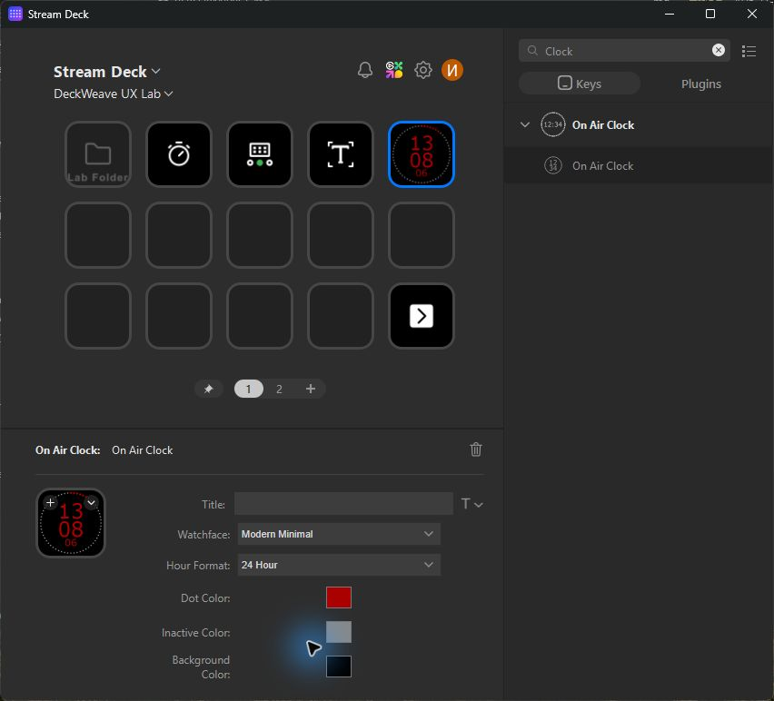

# Обход установленного Stream Deck

Дата: 2026-11-01. Stream Deck **7.6.0.23012**, Windows 11. Это наблюдения реального интерфейса, а не проверка нового DeckWeave. Принятые владельцем требования находятся в [DECISIONS](../../DECISIONS.md).

## Результат и границы

Пройден основной путь настройки: новый профиль → страницы → папка → последовательность → Switch → Key Logic → закрепление → простое действие → установленный HTML-виджет. Просмотрены все шесть вкладок Preferences, меню устройства/профиля/страницы, уведомления, оформление, библиотека и магазин. Реально изменены настройки только специально созданного профиля **DeckWeave UX Lab**, кроме временного переключения Show Title в глобальной Style-форме: оно возвращено в исходное значение, Apply не нажат.

Это не полный перебор каждого пункта, каждого стороннего PI и всех сочетаний параметров. Удаление пользовательских данных, входы в сервисы, покупки, установка/обновление плагинов, обновление firmware и системные побочные действия не выполнялись. Отдельно ниже перечислены непроверенные пути. Физического Elgato в Devices не обнаружено; синхронизация с железом не проверена.

В конце выбран исходный **Default Profile / страница 2**, поиск очищен, выбрана пустая кнопка. Лабораторный профиль оставлен для просмотра. Его наличие — единственное намеренно сохранённое добавление в пользовательскую конфигурацию Stream Deck.

Журнал: [72 наблюдения](evidence/streamdeck-ui-audit.json). Он содержит текст доступности и заметки; некоторые Qt-меню доступны только на изображении, поэтому их состав дополнительно описан здесь. Accessibility-дерево иногда отставало от картинки на один захват; перед следующим действием состояние обновлялось.

## Главный экран и библиотека

| Элемент | Проверенный путь и результат | Что переносить в DeckWeave |
|---|---|---|
| Устройство и профиль | Два отдельных раскрывающихся списка над панелью | Контекст устройства и профиля всегда виден |
| Выбор кнопки | Обычный клик показывает нижний инспектор; выбор VS Code не исполнил команду | Выбор не является выполнением; наша отдельная команда «Проверить» уже принята |
| Назначение | Перенос действия справа на пустую кнопку сразу создаёт назначение и открывает параметры | Не требовать технических draft/review/apply для обычного назначения |
| Поиск | Timer, Text и Clock отфильтровали действия, сохранив заголовок их категории | Один поиск по назначаемым действиям |
| Keys / Plugins | Keys — библиотека действий; Plugins загружает карточки Marketplace с Get/Buy | Установка пакета и назначение действия должны оставаться различимыми |
| Настройка списка | Кнопка возле поиска открывает флажки видимости и ручки перестановки; Done возвращает список | Это настройка библиотеки, не основной режим редактирования устройства |
| Уведомления | Сообщения об установленных плагинах объясняют, что действия находятся в Actions List | После установки показывать следующий понятный шаг |
| Меню аккаунта | Просмотрены View account / Sign out; ни один не вызван | Авторизация не нужна для базовой локальной настройки DeckWeave |
| Контекст кнопки | Пустая: создание Folder/Multi Action/Key Logic, импорт; заполненная: Pin, Copy, Export, фон, Delete и перенос в контейнеры | Частые операции рядом с объектом; опасные операции должны быть различимы |

Особенность автоматизации: `drag` в Qt оставлял видимый переносимый объект; подтверждение кликом в уже наблюдённой области завершало перенос. Это особенность использованного способа управления, не установленный дефект Elgato.

## Профили, страницы, папки и закрепление

1. В списке профилей выбран New Profile. Новый пустой профиль сразу стал текущим. Через Preferences / Profiles имя изменено на `DeckWeave UX Lab`.
2. Плюс под панелью добавил страницу 2 и сразу её открыл. На странице 2 появилась Previous Page внизу слева, на странице 1 — Next Page внизу справа. Операция не потребовала Apply.
3. В пустой ячейке страницы 2 создана папка, задано имя `Lab Folder`. Одиночный клик показывает Title и переход к содержимому; двойной открывает содержимое. Exit появляется автоматически в верхней левой ячейке.
4. Выбор Exit открывает Auto Exit. В лабораторной папке переключатель включён; показано значение 1 second. Возврат из папки выполнен двойным кликом по Exit в редакторе.
5. На папке вызван Pin. На странице 1 в той же позиции появилась серая унаследованная папка. Кнопка со значком булавки возле страниц открыла отдельный слой закреплённых назначений. В нём папка редактируется как обычная; подсказка объясняет наследование в пустые позиции всех страниц.
6. В Navigation раскрыты Create Folder, Switch Profile, Previous Page, Next Page, Go to Page, Page Indicator. Switch Profile назначен на странице 1: параметр Profile по умолчанию Next Profile, варианты также включают оба существующих профиля. Исполнение перехода действием не проверялось.
7. Контекст страницы содержит Duplicate, Delete, Copy, Paste, Configure. Configure открывает Preferences / Profiles с выбранной страницей: Page Name и Change Icon. Контекст профиля содержит Duplicate, Rename, Delete, Export, Backup All. Экспорт и удаление не выполнялись.

Наблюдение закрепления в пустой позиции не доказывает поведение локального переопределения занятой ячейки. Это отдельный сценарий для будущей сверки. Принятое требование DeckWeave сильнее одной проверки редактора: переходы UI и физического устройства должны работать через общее состояние навигации.

## Multi Action, Delay и Switch

Multi Action создан через контекст пустой ячейки страницы 2. Редактор последовательности заменяет изображение устройства; справа остаётся библиотека допустимых шагов, снизу — параметры выбранного шага. Есть явный возврат к панели.

Добавлены Delay и Open. Delay изменён с 1000 до **250 ms**. В Open задан `C:\Windows\System32\notepad.exe`; путь распознан, команда не запущена. Выбор шага показывает его параметры, а не параметры всей последовательности.

Отдельная кнопка настроек задержек открывает два значения по 100 ms: между нажатием/отпусканием и до следующего действия. Это другой механизм, чем явно добавленный шаг Delay. Есть Reset и Learn More; значения не менялись.

Multi Action Switch имеет отдельные переключатели ветвей **1 / 2** вверху редактора. Во вторую добавлен Delay 1000 ms; при переключении обратно первая осталась пустой. В общем инспекторе видны два состояния изображения и связь подписи. Чередование ветвей по реальным нажатиям не проверено.

Во время исследования ошибочно нажата кнопка удаления вместо кнопки задержек: исчез только тестовый шаг Open в лабораторной последовательности. Ctrl+Z его не восстановил; шаг и путь созданы заново. Пользователь уведомлён. Это не проверка штатной Undo-модели всех объектов. При дальнейшем обходе безымянные кнопки различались по полному accessibility ID (`pb_delete` / `pb_multiActionDelays`).

Для DeckWeave нужны отдельные сущности «последовательность», «ветвь Switch» и «пауза», но их внутренние типы не должны появляться в обычном пользовательском пути. Будущая проверка должна охватить порядок выполнения, остановку и повторное нажатие во время Delay.

## Key Logic

Создано назначение Key Logic. Его редактор показывает три крупные области: **Single Press / Double Press / Hold**. В Hold добавлен Hotkey. В списке Preset Actions выбран Copy: поле сочетания и автоматический заголовок получили Ctrl+C. Одиночная и двойная ветви остались пустыми; исполнение сочетания не запускалось.

Preset Actions группирует готовые сочетания по редактированию, общим действиям, управлению окнами и снимкам экрана. Наблюдались Copy/Paste/Undo/Redo/Save и другие пункты; системные команды не выполнялись.

Визуальную структуру можно повторить. Порог удержания, окно двойного нажатия, подавление одиночной ветви до определения двойной, отмена при disconnect и отсутствие аппаратного up у некоторых контролов ещё требуют собственного контракта и тестов. Вид формы не доказывает эти правила.

## Простые действия и оформление

| Действие/форма | Проверено |
|---|---|
| Timer | Назначен на странице 1. Title, Duration (30 seconds), Sound (Connect). В меню звука: None, Connect, Connection Lost, Disconnect, Find, Other. Таймер не запускался |
| Text | Назначен на странице 1. Многострочный текст, счётчик, Press Enter after message. Text Mode: Paste from Clipboard / Simulate typing. Отправка текста не выполнялась |
| Open | Настроен как шаг Multi Action с существующим локальным EXE; исполнение не проверено |
| Open Application | Назначен на странице 1. App — список установленных приложений; Bring to front if already running включён. Long Press: Do Nothing / Quit Application / Force Quit Application, исходно Quit Application. Приложение не выбрано, ничего не запускалось |
| Close | Назначен на странице 1. App / File, выбор файла, Force quit исходно выключен. Цель не задана, закрытие не выполнялось |
| Website | Назначен на странице 1. URL и Open with (Default Browser). Адрес пустой, переход не выполнялся |
| Multimedia | Назначен на странице 1. Previous Track, Play/Pause, Next Track, Stop, Mute, Increase/Decrease Volume. Команды не исполнялись |
| Hotkey | Внутри Hold выбран готовый Copy; Ctrl+C заполнено автоматически |
| Hotkey Switch | Назначен на странице 1. Два поля сочетаний, два состояния иконки, связывание подписи. Сочетания оставлены пустыми |
| Go to Page / Page Indicator | Назначены на странице 1. Первый содержит Page selector (исходно 1); второй показывает номер страницы и общие параметры подписи/иконки |
| Play Audio | Назначен на странице 1. Файл, режим Play/Stop, Play/Overlap, Play/Restart, Loop/Stop, fade, volume, output. Файл не выбран, звук не запускался |
| Stop Audio | Назначен на странице 1. Только общие параметры подписи/иконки; не исполнен |
| Brightness | Назначен на странице 2. Brighter, Darker, Maximum, High, Medium, Low, Minimum. Яркость не изменялась |
| Sleep | Назначен на странице 2. Общие параметры и ссылка Open Preferences для сна/заставки. Команда не исполнялась |
| Random Action | Создан на странице 2. Отдельный редактор списка с возвратом, пустой областью переноса и Content: 0 actions. Шаги и случайное исполнение не проверены |
| Подпись | Раскрыта локальная форма Show Title, верх/центр/низ, font, size 12 px, bold/italic/underline, color и reset; параметры не менялись |
| Иконка | Просмотрены Set from File, Create New Icon, Open Stream Deck Icon Library. Библиотека открыта: поиск, категории пакетов, zoom, получение дополнительных пакетов. Файлы не выбирались |

Встроенное удержание Open Application нужно согласовать с Key Logic: оболочка не должна одновременно исполнять Hold-ветвь и скрытое закрытие приложения. Это техническая задача контракта композиции, не основание добавлять пользователю ещё один общий режим.

## Доступность виртуальной панели

В библиотеке Stream Deck найдено и назначено на странице 2 действие **Toggle Virtual Stream Deck**. Его инспектор показывает отключённый Device selector: **No Virtual Stream Decks configured**. В меню устройств доступны добавления Mobile/Network, но Add Virtual Device отсутствует.

Согласно [справке Elgato](https://help.elgato.com/hc/en-us/articles/35492041288337-Elgato-Stream-Deck-How-to-Add-and-Remove-a-Virtual-Device-Virtual-Stream-Deck), Virtual Stream Deck требует разблокировки совместимым устройством или Mobile Pro. Отсутствие пункта согласуется с этим ограничением; состояние лицензии отдельно не устанавливалось. Виртуальная панель не создана, её действия не исполнены. Для DeckWeave собственная виртуальная панель и «Проверить» остаются обязательными и не должны зависеть от наличия фирменного железа.

## Установленные плагины

**On Air Clock 1.3.0:** назначен в лабораторный профиль. Под общим Title загружается исходный HTML Property Inspector: Watchface, Date Format, Hour Format и цвета. Часы обновляются в самой сетке и в превью инспектора без физического Elgato. При выборе Watchface **Default → Modern Minimal** оба изображения изменились сразу, без Apply. Смена вида также перестроила набор полей: Date Format исчез из текущей формы. Это проверенный пример динамической формы плагина и живого feedback.

**Visual Studio Code:** в исходном профиле выбран существующий Execute Terminal Command. HTML PI успешно показал Getting Started и Command. Поле не редактировалось, команда не запускалась. Регистрация backend в старом совместимом host описана отдельно в [COMPATIBILITY](COMPATIBILITY.md).

Codex и Weather видны в исходном профиле; их защищённые пакеты не объявляются совместимыми с новым приложением. Наблюдение работающей кнопки в официальном Stream Deck не доказывает запуск в стороннем host.

## Preferences: все вкладки

| Вкладка | Просмотренные элементы | Что реально изменено |
|---|---|---|
| General | Версия, Check for Updates, автообновление, автозапуск, сброс Don't Ask Me, Help, MCP Deck / Setup | Ничего |
| Devices | Device Name, Enabled, Visual Orientation, Sleep After, Screensaver, Brightness, Firmware | Ничего |
| Accounts | Пустой список; плюс предлагает Streamlabs/Twitch/YouTube | Ничего; входы не выполнялись |
| Profiles | Профили/страницы, переименование, Application, default profile, имя/иконка страницы, контекстные операции | Имя нового лабораторного профиля |
| Plugins | Marketplace, установленные плагины; детали On Air Clock с версией/автором/обновлением/ссылкой помощи | Ничего; обновления/удаление не выполнялись |
| Style | Overlay прогресса Multi Action; общие title/font/position/color кнопок и подпись/цвет крутилок; Apply/Revert | Show Title временно выключен и возвращён, без Apply |

Devices / Visual Orientation разделяет поворот иконок/текста (Standard, 90, 180, -90) и переворот устройства. Sleep After предлагает Never, 5/15/30 minutes, 1/2 hours. Brightness отображался как 80. Firmware сообщает **No device found**.

Set Screensaver открывает отдельный Customize Image: перенос изображения, Image from file, Snap to edges, масштаб/подгонка, Set Image и Cancel. Без изображения Set Image отключён. Окно закрыто без применения.

В Profiles объяснение Smart Profiles прямо связывает автоматику с **закрытым окном Stream Deck** и выбранным foreground application. Application предлагает обнаруженные приложения и Other. Для лабораторного профиля оставлено None, default profile не менялся. Реальное автоматическое переключение по foreground не проверялось.

Глобальная Style-форма действительно имеет Apply/Revert. Поэтому требование «без Apply» следует относить к обычному назначению и его параметрам; массовая операция оформления — отдельный пользовательский сценарий, не основание вернуть старую процедуру применения всего документа.

## Marketplace

Кнопка магазина официального приложения открыла **Elgato Marketplace во внешнем браузере**. Автоматизация этого окна завершилась тайм-аутом доступа. Публичный каталог продолжен во встроенном браузере; учётная запись из внешнего браузера не переносилась.

На странице Plugins просмотрены категории Plugins/Profiles/Icons/Screensavers/Soundboards, фильтры OS/Type/Dial/Neo Infobar/Free, сортировка Recent и карточки с Get/Buy. Открыт поиск, введён OBS: результаты разделены по типам контента. Открыта [официальная карточка OBS Studio](https://marketplace.elgato.com/product/obs-studio-35615969-830f-45c9-ba0a-1a295bba7fec) и её Show history. Карточка разделяет обзор, изменения, платформы, требуемую версию host, версию пакета, поддержку и дополнительные ссылки. Никакие Get/Buy/Add to cart не нажимались.

На дату обхода карточка показывает **3.0.3.31**, а история сообщает о внутренней переработке в **3.0.0.25**. Архивная проба 2.2.4 не описывает современный транспорт 3.x. По одной карточке нельзя установить wire protocol. Для собственных OBS-действий принят стандартный obs-websocket; совместимость конкретного стороннего пакета проверяется отдельно по его версии.

Для первого DeckWeave достаточно каталога необязательных плагинов из `plugin-registry` с явными версиями и состоянием совместимости. Marketplace Elgato остаётся UX-референсом, а доступность карточки не означает право или техническую возможность автоматически установить любой её пакет.

## Что осталось непроверенным

- Физические down/up/encoder/touch, вывод на LCD, reconnect и синхронизация редактора с устройством.
- Фактическое исполнение Multi Action/Switch/Key Logic, таймера и системных действий; временные правила жестов.
- Реальное переключение Smart Profiles при закрытии/открытии окна.
- Конфликт pinned action с локальным назначением, глубокая вложенность и пределы страниц/папок.
- Round-trip импорта/экспорта/backup, восстановление после crash и гарантии записи на диск. Переход между страницами в одной сессии не доказывает persistence после restart.
- Исполнение Open Application/Close/Multimedia/Soundboard/Random Action, все вложенные параметры и все формы сторонних плагинов. Основные формы этих встроенных действий просмотрены. Dial Stack и Action Wheel теперь включены владельцем в первый полноценный выпуск; их прежнее откладывание отменено.

## Уточнение после замечаний владельца

Этот обход фиксирует преимущественно настройку форм. Он не подтверждает исполнение Multi Action/Switch, изменение кнопки после реального нажатия, точную интерпретацию Key Logic или работу крутилок и сенсорной полосы. Переход к проектированию на основании только этого обхода преждевременен. Дополнительное исследование: [механика действий](ADVANCED-INTERACTIONS.md), [сравнение реализаций](REFERENCE-IMPLEMENTATIONS.md), [видео](VIDEO-REVIEW.md), [оставшиеся проверки](RESEARCH-GAPS.md).
- Авторизация, установка/обновление/удаление через магазин, платные продукты, обновление firmware.

Эти пункты не требуют повторно согласовывать уже принятые требования. Для реализации они переводятся в технические стенды и сценарии приёмки; продуктовый вопрос нужен только при реальной неоднозначности поведения.
